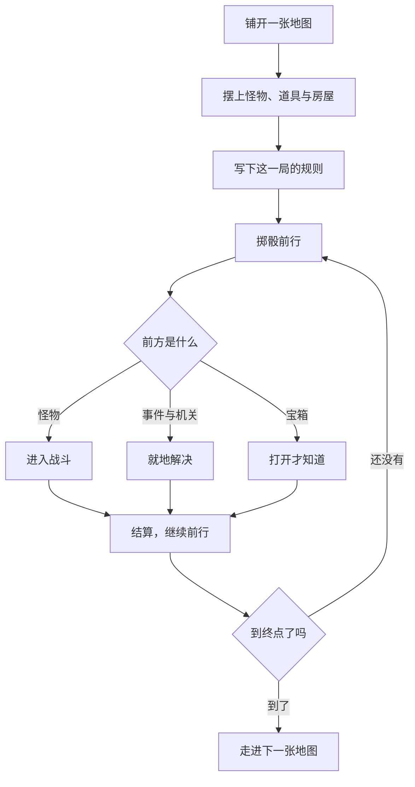
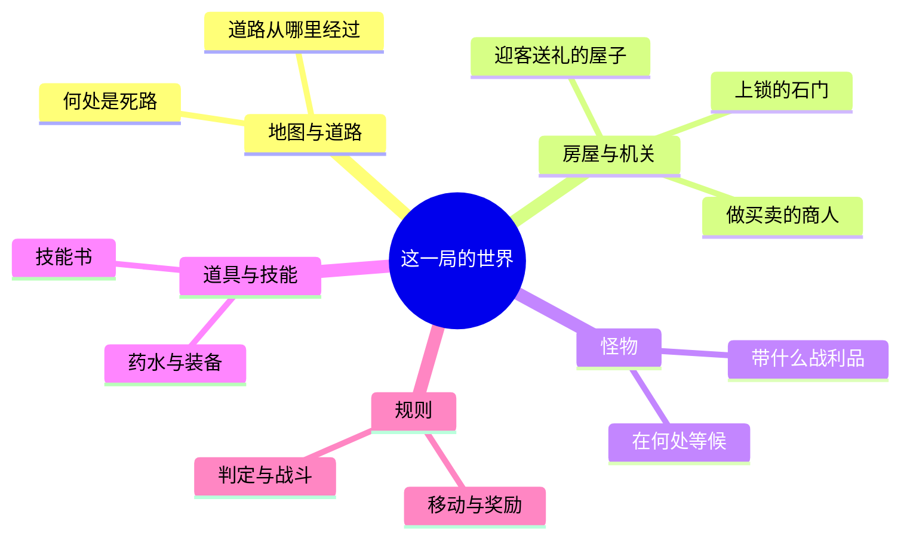

# PopRPG

**单人跑团（Solo TTRPG）的网页实现。**

一个人，一个浏览器，就能开一场冒险。地图、怪物、道具与规则都由你写下来，然后亲自走进去。

## 一局游戏如何展开

上半程是搭台，下半程是走进去。搭台时你说了算，走进去之后——怪物、宝箱与事件当场揭晓，那一局才真正开始。

## 亲手搭起一个世界

- **地图由你铺陈**：道路从哪里经过，房屋落在何处，怪物在何处等候，宝箱藏在哪个角落。
- **怪物、道具与技能都可以自己设定**：这一局的判定、战斗与移动规则，也同样由你决定。
- **想要的内容大多能亲手添进去**：迎客送礼的屋子、做买卖的商人、伪装成宝箱的怪物，都可以加进地图。
- **难度由你的设计决定**：地图上若有走不通的地方，会提醒你；至于这一局好玩与否，由你拿捏。

## 一个人的冒险

- **掷骰前行**：每回合掷骰决定步数，在地图上行走；遭遇怪物便进入战斗。
- **六项属性自由分配**：生命、法力、物攻、魔攻、物防、魔防——战士也可以主修魔攻，法师也可以主修生命。
- **技能不绑职业**：战士也能放火球，法师也能学治疗。技能书是一件寻常道具，拾到便能修习，也可以丢掉或卖掉。
- **每一道难关都有钥匙**：火焰山配火抗鞋，河流配小船，石门配撬锁工具——解开谜题，寻找通过的方法。
- **地形各有各的通过方式**：沼泽拖慢脚步，火焰山灼烧生命，河流拦住去路。
- **准备得愈充分，掷骰所能左右的分量便愈小**：属性、装备、职业与状态都计入判定。
- **每一场交锋都留有结算**：胜负出在哪一步，回头看得分明。
- **宝箱里装着什么，只有打开才知道**：药水、装备、金币，或是一只伪装成箱子的怪物。
- **抵达终点，这一场便算完成**：此后还能接着走进下一张地图。

## 分享

分享自己的奇思妙想，就算是远隔千里的朋友，也能去同一个地方探险。

---

**手机与电脑皆可游玩。**
