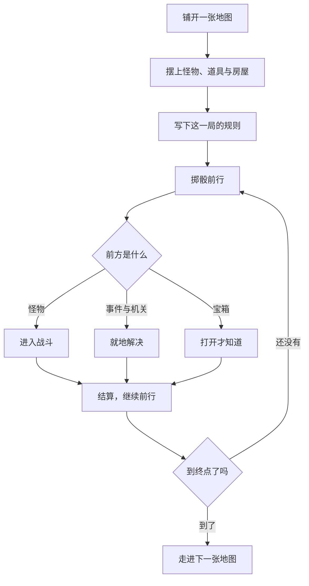
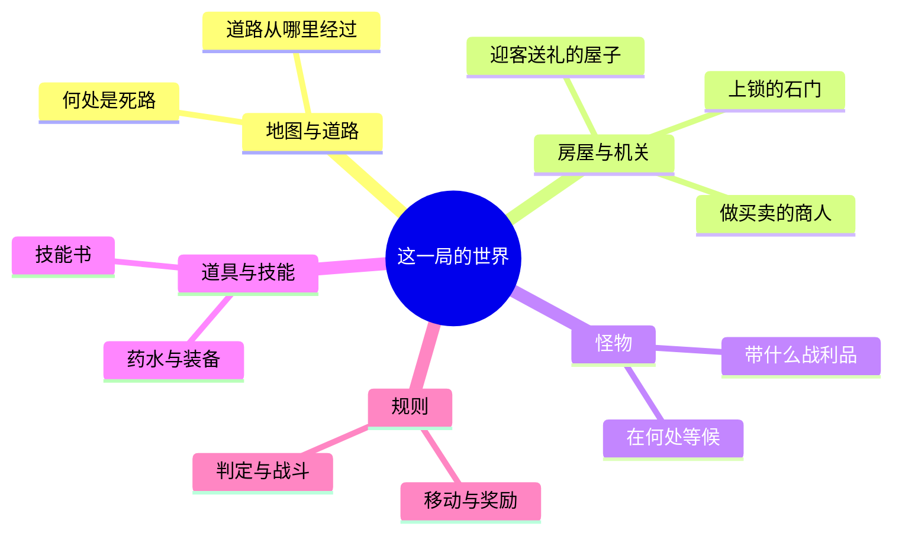
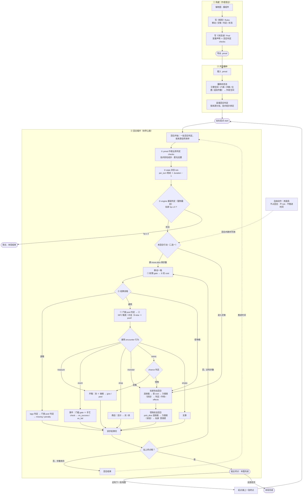
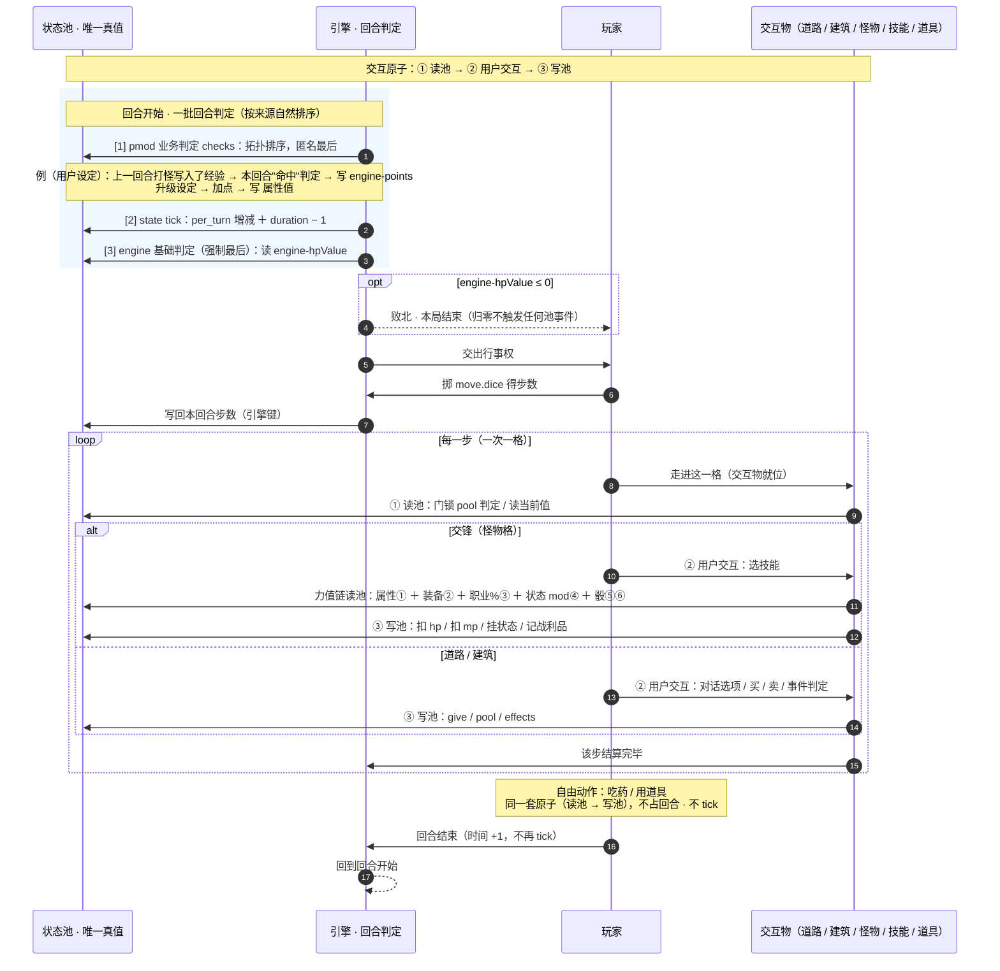
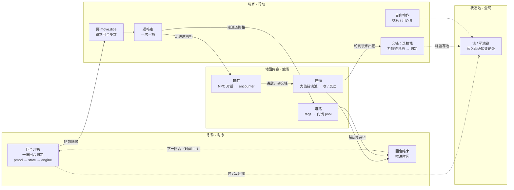
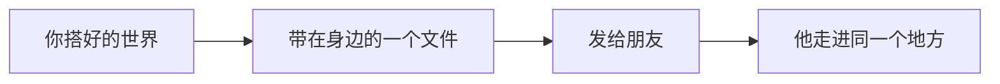

# PopRPG

**单人跑团（Solo TTRPG）的网页实现。**

一个人，一个浏览器，就能开一场冒险。地图、怪物、道具与规则都由你写下来，然后亲自走进去。

## 一局游戏如何展开

上半程是搭台，下半程是走进去。搭台时你说了算，走进去之后——怪物、宝箱与事件当场揭晓，那一局才真正开始。

## 亲手搭起一个世界

- **地图由你铺陈**：道路从哪里经过，房屋落在何处，怪物在何处等候，宝箱藏在哪个角落。
- **怪物、道具与技能都可以自己设定**：这一局的判定、战斗与移动规则，也同样由你决定。
- **想要的内容大多能亲手添进去**：迎客送礼的屋子、做买卖的商人、伪装成宝箱的怪物，都可以加进地图。
- **难度由你的设计决定**：地图上若有走不通的地方，会提醒你；至于这一局好玩与否，由你拿捏。

## 一个人的冒险

- **掷骰前行**：每回合掷骰决定步数，在地图上行走；遭遇怪物便进入战斗。
- **六项属性自由分配**：生命、法力、物攻、魔攻、物防、魔防——战士也可以主修魔攻，法师也可以主修生命。
- **技能不绑职业**：战士也能放火球，法师也能学治疗。技能书是一件寻常道具，拾到便能修习，也可以丢掉或卖掉。
- **每一道难关都有钥匙**：火焰山配火抗鞋，河流配小船，石门配撬锁工具——解开谜题，寻找通过的方法。
- **地形各有各的通过方式**：沼泽拖慢脚步，火焰山灼烧生命，河流拦住去路。
- **准备得愈充分，掷骰所能左右的分量便愈小**：属性、装备、职业与状态都计入判定。
- **每一场交锋都留有结算**：胜负出在哪一步，回头看得分明。
- **宝箱里装着什么，只有打开才知道**：药水、装备、金币，或是一只伪装成箱子的怪物。
- **抵达终点，这一场便算完成**：此后还能接着走进下一张地图。

## 游戏流程拓扑（V2.3 设计）

> V2.3 引入**全局状态池**后的完整流程拓扑。**回合是全篇唯一的时间轴**——一切按回合结算。

### 组件通信时序（V2.3）

> 组件之间"谁在什么时候跟谁说话"用**时序图**表达：**纵轴 = 时间**（自上而下），**横轴 = 参与者**——每条生命线就是一条泳道。
>
> **结构原子**：每一次交互都是 **`交互物 → 读状态池 → 用户交互 → 写状态池`**——**一切基于状态**。下面这张图就是把这条原子展开成一回合。

**怎么读**

- **结构原子**：每一组"交互物 → 池"的箭头都是 **读池 / 写池** 两拍，中间夹一次**用户交互**。内容侧从不直接改数，一律经池——所以状态池是**唯一真值**。
- **力值链本身也读池**：`属性① ＋ 装备② ＋ 职业%③ ＋ 状态 mod④ ＋ 骰⑤⑥` 全是从池里取。攻击与反击走**同一条链**，只是取不同维度。
- **死亡判定在回合开始，不在回合结束**：它是 `engine` 内置基础判定，在"一批回合判定"里**强制最后**执行——先跑 `pmod`（含用户的经验 / 升级设定）与 `state` tick，最后才判 `engine-hpValue ≤ 0`。
- **经验 / 升级不是引擎机制，而是 `pmod` 回合判定**：上一回合打怪写经验入池 → 本回合 `pmod` 的"命中"判定 → 写 `engine-points` / 属性值。引擎只保证它**每回合开始按来源排一次**。
- **自由动作不占时间轴**：`Note over P` 标出吃药 / 用道具随时可插，走的还是同一套"读池 → 写池"，不 tick、不推进时间。
- **出口**：`opt engine-hpValue ≤ 0 → 败北` 在回合开始判；`站上终点格 → 本图完成`在"逐格走"内循环里判，此处省略以保可读。

### 责任泳道（flowchart 子图版 · 全渲染器兼容）

> **为什么不用 `swimlane-beta`**：那是 Mermaid v11.16+ 才有的 beta 图表类型，GitHub 与 VS Code（11.12）等渲染器都还不认，会直接渲染失败。
> **为什么不用 PlantUML**：GitHub 原生 Markdown 只支持 `mermaid` / `geoJSON` / `topoJSON` / `ASCII STL` 四种图表语法，**不含 PlantUML**。下面这版用 `flowchart` + 顶层 `subgraph` 伪装泳道，**任何支持 Mermaid 的渲染器都能预览**。

**横向 = 时间**（一回合从左到右），**纵向 = 四条泳道**。

**泳道对照**

| 泳道 | 谁 | 在这一回合里做什么 |
|---|---|---|
| 引擎 · 时序 | 引擎 | 回合**开始**整批判一次（基础判定强制最后）；回合**结束**推进时间 |
| 玩家 · 行动 | 玩家 | 掷骰得步数 → 逐格走 →（遭遇怪物）选技能；**吃药随时可做** |
| 地图内容 · 触发 | 道路 / 建筑 / 怪物 | 走进去的那一下**就地**判定与结算（门锁 pool、NPC 对话、encounter、交锋） |
| 状态池 · 全局 | 状态池 | 四条泳道都读它、都可能写它；写入即通知关心它的使用处 |

- **一回合 = 一条从左到右的横线**：`回合开始 → 掷骰 → 逐格走（含触发）→ 回合结束 →（下一回合）`。
- **只有两条泳道推进时间**（引擎的回合开始 / 回合结束）；玩家行动与地图触发都发生在这一回合**之内**。
- **自由动作不占横线**：吃药 / 用道具随时插进来，不推进时间、不 tick。
- **两个出口不在这张图里**：**败北**在"回合开始"的引擎泳道判出、**抵达终点**在"逐格走"里判出——见上面时序图的 `opt` 与第一张拓扑图的 `LOSE` / `CLEAR`。

### 闭环与边界

- **闭环**：`回合开始（一批回合判定）→ 本回合行动 → 回合结束 → 下一回合开始`——除下面两个出口外，流程永远回到"回合开始"。
- **两个出口**：① **抵达终点** → 走进下一张地图（起点自动接上一张终点；全部走完即本局完成）；② **玩家 `hp ≤ 0`** → 在回合开始的 `engine` 基础判定里判死 → **败北**。
- **回合判定只有一批**：`pmod` 业务（作者设定先执行）→ `state` tick → `engine` 基础判定（**强制最后**）；没有独立的"存活判定步"，也没有独立的"状态 tick 步"。
- **缓冲靠自由动作**：`hp` 降到 `0` 只在回合**开始**判死，本回合内仍可**随时吃药**（不占回合）；次回合 `state` tick 的"回血 / 掉血"对冲后才判死——上个回合吃过药，下个回合就死不掉。
- **自由动作与触发判定不占回合**：用道具，以及门锁 / 对话 / 建筑的所有**触发判定**，都在回合内**就地结算**，不推进时间、不 tick。
- **不会卡死**：保底技能免费（没蓝也能打）；状态必有 `duration` 上限（不存在永久状态）；依赖缺名只忽略该条、成环按声明顺序兜底。
- **观察即时**：池键一写入即通知登记处，正在展示的对话按新值**即时重算当前层**。

---

## 分享

分享自己的奇思妙想，就算是远隔千里的朋友，也能去同一个地方探险。

---

**手机与电脑皆可游玩。**
